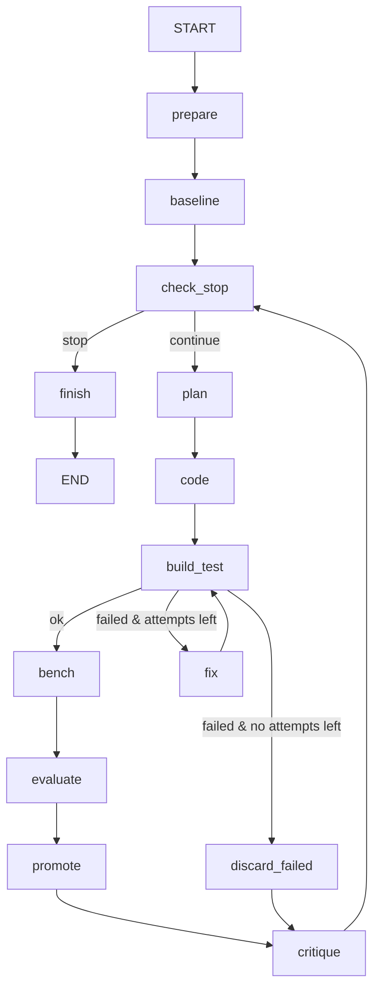

# 09 — Optimization loop as a LangGraph graph

Modules: `perf_agent/agent/{state,nodes,graph}.py` · Milestone M8
Nodes depend only on ports, the three agents and the Evaluator.

## Graph



Any node may set `state.trial_error`; the router then sends the run to `discard_failed`.

## State (`agent/state.py`)

A `TypedDict` (LangGraph state). Only JSON-serialisable values (Pydantic models via `.model_dump()`
or plain types) so the checkpointer can save it.

```python
class LoopState(TypedDict, total=False):
    run_id: str
    base_version: str                 # current base, e.g. "graph_V2"
    initial_baseline: dict            # BenchmarkResult of the starting version
    baseline: dict                    # BenchmarkResult of the current base
    trials: list[dict]                # finished Trial objects
    # current trial
    trial_index: int
    trial_dir: str | None
    idea: dict | None
    source_before: str
    source_after: str | None
    build_attempts: int
    last_log: str
    bench: dict | None
    verdict: dict | None
    trial_status: str | None
    trial_error: str | None
    trial_started_at: str
    # end
    stop_reason: str | None
```

Helper functions convert between dicts and models; nodes work with models internally.

## Nodes (`agent/nodes.py`)

Each node is a function `(state) -> dict` (partial state update). Dependencies are injected with a
`Deps` dataclass bound via `functools.partial` when the graph is built.

| Node | Does |
|---|---|
| `prepare` | `versions.cleanup_stale_trials()`, `versions.check_base(base)`, `repo.start_run` |
| `baseline` | build + test the base (must pass, else fatal error), `project.benchmark`, `repo.save_baseline` |
| `check_stop` | computes `stop_reason` (table below) or `None` |
| `plan` | `planner.propose(...)` → `idea`, resets current-trial fields, `trial_index += 1` |
| `code` | `versions.create_trial(base)`, `coder.implement`, `project.write_component` |
| `build_test` | `project.build` then `project.test`; stores `last_log`, increments `build_attempts` |
| `fix` | `coder.fix(source_after, tail(last_log), idea)`, `project.write_component` |
| `bench` | `project.benchmark(trial_dir, combos)` |
| `evaluate` | `evaluate(baseline, bench, accept_threshold_pct)` → `verdict`, `trial_status` |
| `promote` | ACCEPTED → write `VERSION.json`, `versions.promote`, new `base_version` and `baseline`, `repo.save_version`; else `versions.discard` |
| `discard_failed` | `versions.discard(trial_dir)`; status `BUILD_FAILED` or `ERROR` |
| `critique` | `critic.review(...)` (failure → critique None + warning), build the `Trial`, `repo.save_trial`, append to `trials` |
| `finish` | builds `RunSummary`, `repo.finish_run` |

Every node that touches a trial folder wraps its work in `try/except`: on exception it returns
`{"trial_error": summary}` instead of raising, except `BudgetExhausted` (→ `stop_reason=BUDGET_EXHAUSTED`,
trial discarded, then `finish`) and cancellation.

## Routing (`agent/graph.py`)

```python
def build_graph(deps: Deps, checkpointer: BaseCheckpointSaver | None = None) -> CompiledStateGraph
```

- `StateGraph(LoopState)`, nodes as above, `add_conditional_edges` for `check_stop` and `build_test`.
- Set `recursion_limit` in the run config to at least `max_trials * 12 + 10`.
- Checkpointer: `MemorySaver` by default, `SqliteSaver` at `workspace/.perf_agent/checkpoints.sqlite`
  when the CLI gets `--resume`; `thread_id = run_id`. Resuming continues from the last completed node
  (the CLI command `perf-agent run SCENARIO --resume RUN_ID`).
- The CLI uses `graph.stream(..., stream_mode="updates")` to print progress per node.
- `perf-agent graph` CLI command prints `graph.get_graph().draw_mermaid()` (useful for the report / STR).

## Stop conditions (in `check_stop`, first match wins)

| Reason | Rule |
|---|---|
| CANCELLED | cancel event set |
| BUDGET_EXHAUSTED | `registry.spent_usd >= llm_budget_usd` |
| OBJECTIVE_REACHED | `cumulative_gain_pct(initial_baseline, baseline) >= target_gain_pct` |
| MAX_TRIALS | `len(trials) == max_trials` |
| TOO_MANY_ERRORS | last `max_consecutive_errors` trials are ERROR or BUILD_FAILED |
| NO_PROGRESS | last `max_no_progress` trials are not ACCEPTED |

## Invariants

- At the end of each trial, the trial folder is either promoted or deleted. No `*_trial` folder is left after `finish`.
- The base folder is never written to.
- `diff` for the Critic: `difflib.unified_diff(source_before, source_after)`.

## Acceptance criteria (ScriptedChatModel + fake adapter/version manager, plus one real end-to-end)

- Graph compiles; `draw_mermaid()` contains all node names.
- Scripted run: trial 1 accepted (+20 %), trials 2 and 3 rejected → `NO_PROGRESS`, final version `graph_V2`.
- Objective 15 % with a +20 % first trial → `OBJECTIVE_REACHED` after 1 trial.
- Build fails then passes after one `fix` → ACCEPTED, `build_attempts == 2`.
- Build fails 3 times (max_build_fixes=2) → BUILD_FAILED, trial folder deleted.
- Incorrect output → REJECTED_INCORRECT even if faster.
- 3 consecutive errors → TOO_MANY_ERRORS.
- Budget hit mid-run → BUDGET_EXHAUSTED, no leftover `*_trial` folder.
- Resume: run with `SqliteSaver`, interrupt after trial 1 (cancel), resume with the same `thread_id` → continues at trial 2.
- End-to-end with the real `VersionManager` and `JavaAdapter` on the stub project (spec 04.3), scripted
  Coder returning the component with `// SPEED=2` → `graph_V2` created on disk, gain ≈ +100 %, no `*_trial` left.
